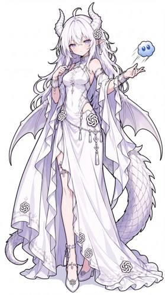
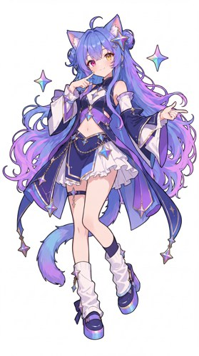
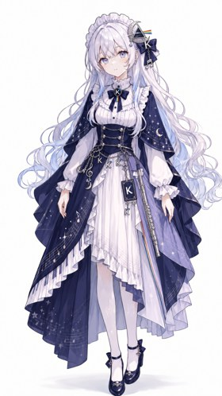
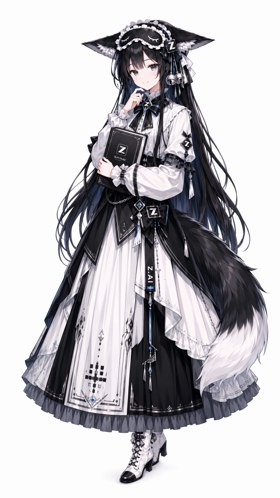
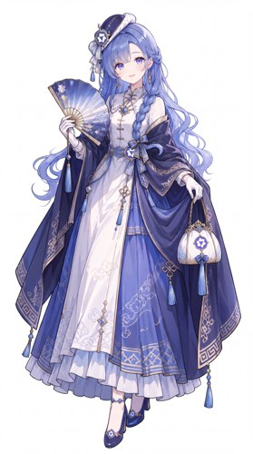

# AI Girls Atlas · AI 娘形象与二创资料库

整理AI拟人角色的立绘、Q版、三视图、表情、视频与声音：看形象、选作者版本、找原图与制作来源。资料更新至 **2026-10-21**。

## 这次新增

- **50张本地图片**：18张校园人设、20张常规/Q版派生、7张重点仓库新增图、MiniMax/Llama两张早期立绘、三张透明表情。
- **已有角色继续扩写**：Claude工程服、DeepSeek短裙与表情、Llama变体、混元/Mistral原图、MiMo作者立绘与三视图，以及多角色校园版本。
- **声音与热视频**：12条声音来源，整理音色、歌曲、翻唱、MV和原曲；为本轮候选保存播放快照。
- **按作者版本查找**：43条扩写版本、14个项目评述、11张本地表情语境索引。没有把不同作者的同名角色合并。

## 从这里看

- **[新增网站与GitHub项目评述](docs/09-more-sources.md)** · **[已有角色的版本比较](docs/10-variant-guide.md)**
- **[表情、动作与素材用途](docs/11-expression-and-materials.md)** · **[声音与较热视频](docs/12-audio-and-popular-videos.md)**
- [六个重点来源的首轮详细提炼](docs/01-focus-sources.md) · [原有视频/作品导航](docs/03-resource-library.md)
- [角色体系](docs/02-character-system.md) · [来源比较](docs/04-source-comparison.md) · [创作模板](docs/05-creation-playbook.md)
- [素材使用说明](docs/06-rights-and-provenance.md) · [仍待补的内容](docs/07-gaps-and-roadmap.md) · [核验方法](docs/08-research-method.md)

## 当前收录

| 项目 | 数量 | 说明 |
| --- | ---: | --- |
| 条目 | 39 | 产品、模型、工具、平台及历史/待区分项目命名 |
| 有形象资料或线索 | 32 | 本地图片、档案与外部作品线索分别标注 |
| 有本地图片的角色条目 | 20 | 不同作者版本可共存 |
| 本地原图/派生图/参考文件 | 82 | 保留供应方原字节，含首轮视频展示截帧 |
| 轻量预览 | 11 | 单独计数，不当作新作品 |
| 外部参考 | 49 | 图库原帖与独立宠物版本 |
| 视频记录 | 47 | 含声音上游原曲；观察范围逐条注明 |
| 声音来源 | 12 | 原作品与版本链，不是音频下载包 |
| 表情/作品导航 | 36 | 外链导航与情绪用途 |
| 本地表情语境 | 11 | 对应已有图片的索引 |
| 来源入口 | 204 | 正文、目录、元数据和作者声明分层记录 |
| 待补条目 | 7 | 未找到明确方案的档位继续保留 |

首轮重点来源保留，新增部分按原文件和作品版本去重。两个重点来源的本次变化见[source-updates.json](data/source-updates.json)。

## 八位主角的早期版本

以下缩略图来自 shuaizenge/ai-girls 的公开预览；原设计为 ZipZipPipe，DeepSeek 另保留上善无形原角色署名。预览只是入口，完整署名与使用状态见各角色页及 [THIRD_PARTY_NOTICES.md](THIRD_PARTY_NOTICES.md)。

| DeepSeek | GPT | Claude | Gemini |
| --- | --- | --- | --- |
|  |  |  |  |
| [Grok](characters/grok/README.md) | [Kimi](characters/kimi/README.md) | [GLM](characters/glm/README.md) | [Qwen](characters/qwen/README.md) |
|  |  |  |  |

另有 [Seed娘立绘](characters/seed/README.md)：本次从原图SEED工牌与豆包玩偶确认身份，纠正了上游将其归入Gemini变体的分类，原字节保留；见[data/corrections.json](data/corrections.json)。

还有 JAdpp 的六张独立角色立绘和八种鲸鱼娘表情，放在各角色页中。它们有自己的设计、署名与文件许可，不冒充上图早期原版。

## 角色总览

| 角色 | 类型 | 当前状态 | 识别点/缺口 |
| --- | --- | --- | --- |
| [DeepSeek / 深度求索](characters/deepseek/README.md) | model-family | 本地图片 | 蓝色长发；鲸鱼鳍状耳饰与鲸尾；深蓝白女仆裙 |
| [ChatGPT / GPT](characters/gpt/README.md) | product-and-model-family | 本地图片 | 白色长发；龙角、龙翼与长尾；浅色礼服 |
| [Claude](characters/claude/README.md) | model-family | 本地图片 | 橙色长发；花形发饰；米白橙黑层叠长裙与书本 |
| [Gemini](characters/gemini/README.md) | model-family | 本地图片 | 蓝紫渐变长发；猫耳猫尾；异色瞳与星形元素 |
| [Grok](characters/grok/README.md) | model-family | 本地图片 | 金发；黑红或黑色裙装；蝙蝠翼、尖角与斧形道具 |
| [Kimi](characters/kimi/README.md) | product-and-model-family | 本地图片 | 白至银紫色长发；月亮和K元素；黑白深蓝非对称服装 |
| [GLM / 智谱](characters/glm/README.md) | model-family | 本地图片 | 黑色长发；狐耳和蓬松尾部；黑白服装及书本/Z元素 |
| [Qwen / 通义千问](characters/qwen/README.md) | model-family | 本地图片 | 蓝紫长发；圆形发饰；中式衣裙与折扇 |
| [Seed 娘（豆包相关同人）](characters/seed/README.md) | model-family | 本地图片 | 紫蓝单马尾；蓝白服装；豆包挂件 |
| [MiniMax](characters/minimax/README.md) | model-family | 本地图片 | 橙色短发；粉色贝雷帽；场记板、照片与创作道具 |
| [Llama](characters/llama/README.md) | model-family | 本地图片 | 白色长卷发；白色猫耳；宽松白色外套 |
| [Mistral](characters/mistral/README.md) | model-family | 本地图片 | 金色长发；红色宽檐帽；红白法师裙 |
| [Perplexity](characters/perplexity/README.md) | product | 本地图片 | 墨绿色长发；绿系长袍；星形法杖 |
| [文心 / ERNIE](characters/wenxin/README.md) | model-family | 本地图片 | 蓝色方块发夹；蓝色系头发；中式衣裙 |
| [RWKV](characters/rwkv/README.md) | model-family | 档案与外链 | 深紫长发；放射状王冠；紫色羽翼与羽毛服饰 |
| [腾讯混元 / Hunyuan](characters/hunyuan/README.md) | model-family | 本地图片 | 深色长发；中式长裙；算盘 |
| [JEV 裁判者](characters/jev/README.md) | community-model-reference | 档案与外链 | 黑粉配色；天平；嘴部荆棘 |
| [OpenCode](characters/opencode/README.md) | coding-tool | 作品线索 | 黑色长发；机械感尖角；灰黑服装 |
| [Zcode](characters/zcode/README.md) | coding-tool | 作品线索 | 浅色长发；蒙眼元素；浅蓝白工程少女轮廓 |
| [Codex 龙娘分支](characters/codex/README.md) | coding-tool | 作品线索 | 龙娘分支；细节以作者发布的三视图为准 |
| [Image 2 黑龙娘](characters/image2/README.md) | image-model-reference | 作品线索 | 黑龙娘分支；已有三视图入口 |
| [NovelAI](characters/novelai/README.md) | creative-product | 作品线索 | 本次仅确认生成式模型合照中的形象线索 |
| [Midjourney](characters/midjourney/README.md) | image-product | 作品线索 | 本次仅确认生成式模型合照中的形象线索 |
| [Suno](characters/suno/README.md) | music-product | 作品线索 | 本次仅确认生成式模型合照中的形象线索 |
| [ElevenLabs](characters/elevenlabs/README.md) | audio-product | 作品线索 | 本次仅确认生成式模型合照中的形象线索 |
| [豆包官方头像及其他版本](characters/doubao/README.md) | product | 本地图片 | 官方短发头像有来源；同人造型存在多个分支 |
| [StepFun / 阶跃星辰](characters/stepfun/README.md) | model-family | 作品线索 | 找到三项站点记录；精确外貌和原作许可待原帖逐图核对 |
| [MiMo / 小米](characters/mimo/README.md) | model-family | 本地图片 | 银白双马尾；橙黑服装、mi/MiMo标识；兔子与黑白不对称袜 |
| [Hugging Face](characters/huggingface/README.md) | platform | 作品线索 | 站点条目描述黄色笑脸玩偶与海军蓝外套 |
| [Microsoft Copilot](characters/copilot/README.md) | product | 待补 | 与GitHub Copilot分开；本次未确认采用哪一套社区形象。 |
| [腾讯元宝](characters/yuanbao/README.md) | product | 待补 | 产品条目与混元模型角色分开，未指定同人作者。 |
| [讯飞星火](characters/spark/README.md) | model-family | 本地图片 | 酒红低侧马尾；眼镜与蓝眼；蓝色火焰发夹 |
| [Cohere / Command](characters/cohere/README.md) | model-family | 本地图片 | 森林绿及肩卷发；浅色挑染；桃绿奶油色领结 |
| [可灵 / Kling](characters/kling/README.md) | video-product | 待补 | 官方入口本次读取受限；没有补造角色图或厂商许可。 |
| [Runway](characters/runway/README.md) | video-product | 待补 | 产品有官方入口，未指定成熟社区形象。 |
| [Sora（历史产品）](characters/sora/README.md) | historical-video-product | 待补 | 原入口当前转到官方停用说明；作为历史产品待补档，不列为当前可用服务。 |
| [Stable Diffusion](characters/stable-diffusion/README.md) | image-model-family | 待补 | 模型家族与各WebUI/服务不混同，拟人设计待补。 |
| [FLUX](characters/flux/README.md) | image-model-family | 待补 | 模型家族与厂商分开登记；未找到本次可核验角色档案。 |
| [Copilot（校园项目，具体产品待区分）](characters/copilot-school/README.md) | ambiguous-product-reference | 本地图片 | 青绿色高马尾；多色缎带环徽章；灰蓝校服裙 |

## 六个重点入口

1. [B站《各AI娘形象盘点》](https://www.bilibili.com/video/BV14phK66Ejw/)
2. [B站《各个ai刻板印象》](https://www.bilibili.com/video/BV1pLn36sEJq/)
3. [知乎提示词问题](https://www.zhihu.com/question/2078891449882514701)
4. [GenderSwapAI专题](https://genderswapai.com/ai-gijinka) · [中文](https://genderswapai.com/zh-CN/ai-gijinka)
5. [lmy414/ai-girl-stickers](https://github.com/lmy414/ai-girl-stickers)
6. [shuaizenge/ai-girls](https://github.com/shuaizenge/ai-girls)

## 数据与素材

[data/README.md](data/README.md)列出JSON与CSV。原图在assets中；[THIRD_PARTY_NOTICES.md](THIRD_PARTY_NOTICES.md)逐文件给出作者、原帖、供应方与使用条件。未统一向第三方图片或声音授予许可。

同人形象、声音演绎与模型厂商分别署名；本库为社区整理，与相关厂商无官方关系。贡献新的作者版本、声音或出处可按[投稿说明](CONTRIBUTING.md)补充。

维护检查：`python scripts/verify.py`。它只检查库内资料关系、文件与链接，不运行第三方软件。
