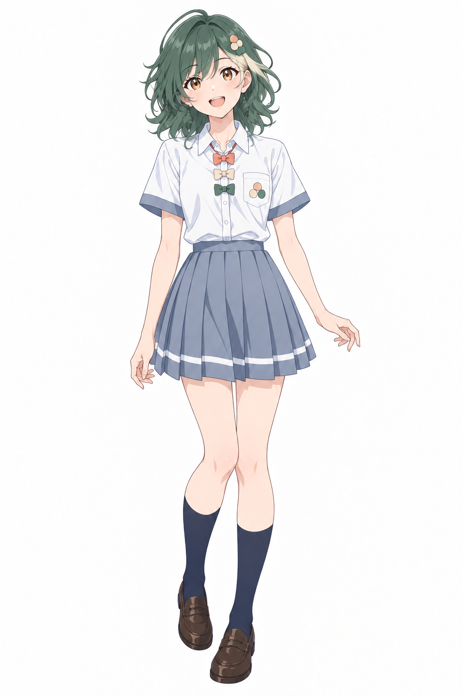

# Cohere / Command

[人设、说话与做事风格](../../encyclopedia/personas/cohere.md)：含证据范围和本库创作版对白。

资料日期：2026-10-21。类型：`model-family`；状态：`local_assets`。

## 形象与版本

署名：lshhhhhhh（AI辅助设计）。

检索别称：Cohere。

该页主要参考版本的识别点：

- 森林绿及肩卷发
- 浅色挑染
- 桃绿奶油色领结

本项目原创方案，补上此前未确认形象的档位。不主张为通行设定或官方形象。

## 本地文件

| 文件 | 类型/系列 | 使用说明 |
| --- | --- | --- |
| [校园系列正面全身人设](../../assets/school-op/cohere/school-op-cohere.png) | school-portrait / school-op | CC-BY-NC-4.0 |

文件保持原字节；完整作者、原帖、下载供应方和SHA-256见[assets.json](../../data/assets.json)。

## 本轮新增与扩写的作者版本

### 校园系列 · school-op

本项目原创方案，补上此前未确认形象的档位。

识别点：森林绿及肩卷发；浅色挑染；桃绿奶油色领结。

[作者发布的提示词文件](https://github.com/lshhhhhhh/ai-school-op/blob/379e83eebe0f5c34eefa81ca4ef8203c1c54ae64/cast/designs/cohere.prompt.txt)。这是该派生系列的提示词，不冒充早期原角色提示词。

## 外部设定、三视图与作品

## 创作参考

先使用校园系列本身的人设图和作者提示词，其他服装另建派生版本。

此段为本库编者建议。

## 来源

- [Cohere / Command 官方入口](https://cohere.com/command) · `official_product_reference`
- [ai-school-op：项目说明和图片许可](https://github.com/lshhhhhhh/ai-school-op/blob/379e83eebe0f5c34eefa81ca4ef8203c1c54ae64/README.md) · `pinned_repository_text`
- [18位校园AI娘演员表](https://github.com/lshhhhhhh/ai-school-op/blob/379e83eebe0f5c34eefa81ca4ef8203c1c54ae64/cast/README.md) · `pinned_repository_text`
- [校园cohere作者提示词](https://github.com/lshhhhhhh/ai-school-op/blob/379e83eebe0f5c34eefa81ca4ef8203c1c54ae64/cast/designs/cohere.prompt.txt) · `pinned_repository_text`

返回[角色总览](../../README.md) · [新增资料评述](../../docs/09-more-sources.md) · [版本比较](../../docs/10-variant-guide.md)。
