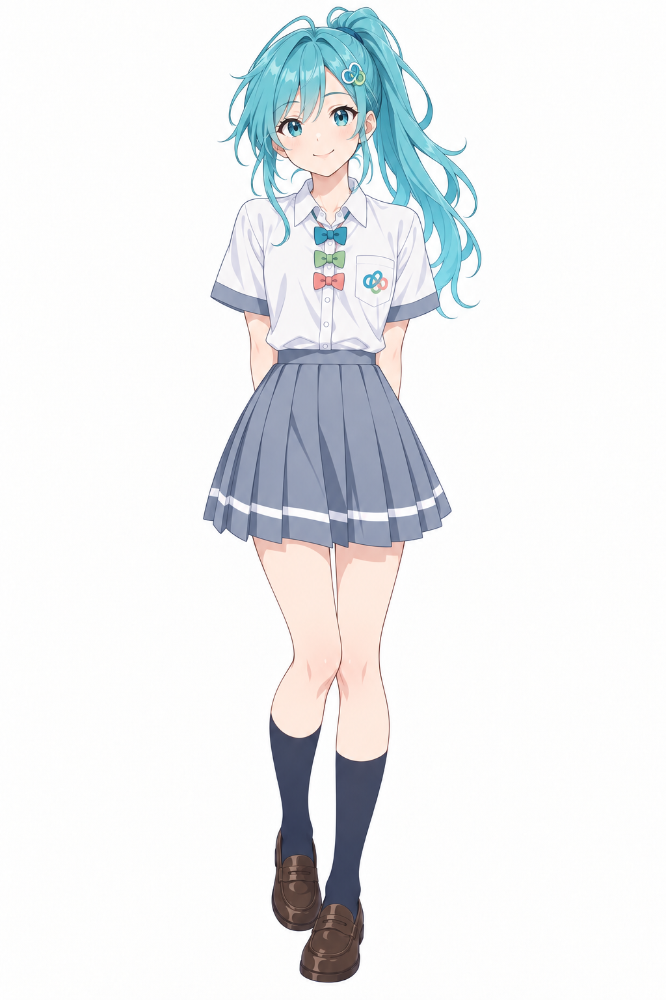

# Copilot（校园项目，具体产品待区分）

资料日期：2026-10-21。类型：`ambiguous-product-reference`；状态：`local_assets`。

## 形象与版本

署名：lshhhhhhh（AI辅助设计）。

检索别称：Copilot娘、校园Copilot。

该页主要参考版本的识别点：

- 青绿色高马尾
- 多色缎带环徽章
- 灰蓝校服裙

作者只标注Copilot，未在该提示词中区分Microsoft Copilot与GitHub Copilot。本库保留项目命名，不据徽章猜定产品。

## 本地文件

| 文件 | 类型/系列 | 使用说明 |
| --- | --- | --- |
| [校园系列正面全身人设](../../assets/school-op/copilot-school/school-op-copilot.png) | school-portrait / school-op | CC-BY-NC-4.0 |

文件保持原字节；完整作者、原帖、下载供应方和SHA-256见[assets.json](../../data/assets.json)。

## 本轮新增与扩写的作者版本

### 校园系列 · school-op

作者未进一步区分具体Copilot产品；单独列项目角色。

识别点：青绿色高马尾；蓝绿眼；多色缎带环胸章。

[作者发布的提示词文件](https://github.com/lshhhhhhh/ai-school-op/blob/379e83eebe0f5c34eefa81ca4ef8203c1c54ae64/cast/designs/copilot.prompt.txt)。这是该派生系列的提示词，不冒充早期原角色提示词。

## 外部设定、三视图与作品

## 创作参考

适合作为该校园系列的角色参考；产品归属确认后再与具体条目建立关系。

此段为本库编者建议。

## 来源

- [ai-school-op：项目说明和图片许可](https://github.com/lshhhhhhh/ai-school-op/blob/379e83eebe0f5c34eefa81ca4ef8203c1c54ae64/README.md) · `pinned_repository_text`
- [18位校园AI娘演员表](https://github.com/lshhhhhhh/ai-school-op/blob/379e83eebe0f5c34eefa81ca4ef8203c1c54ae64/cast/README.md) · `pinned_repository_text`
- [校园copilot作者提示词](https://github.com/lshhhhhhh/ai-school-op/blob/379e83eebe0f5c34eefa81ca4ef8203c1c54ae64/cast/designs/copilot.prompt.txt) · `pinned_repository_text`

返回[角色总览](../../README.md) · [新增资料评述](../../docs/09-more-sources.md) · [版本比较](../../docs/10-variant-guide.md)。
