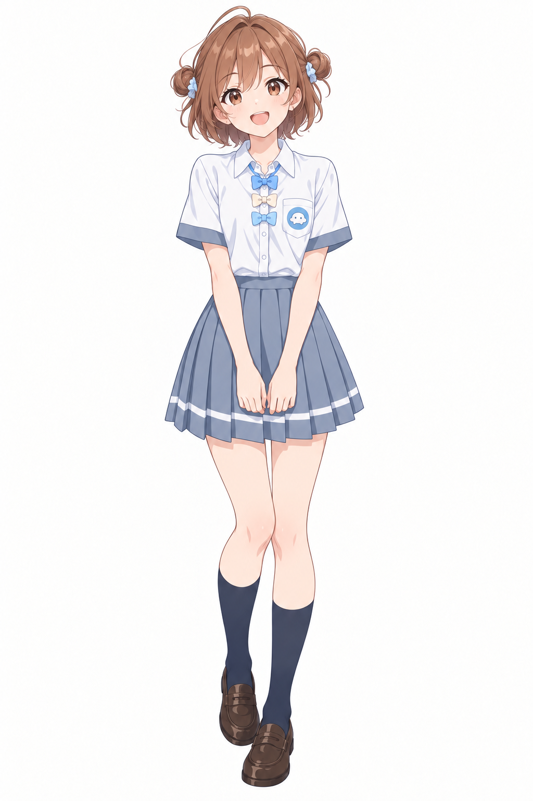

# 豆包 / Doubao

[社区刻板印象、外号与梗](../../encyclopedia/personas/community-impressions.md#doubao)

[人设、说话与做事风格](../../encyclopedia/personas/doubao.md) · [本次形象纠正说明](../../encyclopedia/personas/doubao-correction.md) · [角色总览](../../README.md)

形象观察日期：2026-10-21；目录维护：2026-10-22。产品条目；头像、同人设计与短片演出按版本区分。

## 官网当前头像

头像识别点：棕色偏分短发、黑色领口、浅蓝圆底。查看[官方头像原文件](https://lf-flow-web-cdn.doubao.com/obj/flow-doubao/favicon/new-doubao/192x192.png)。

**出处与署名：豆包官网 / 豆包、字节跳动等对应权利人。** [官网](https://www.doubao.com/chat/)HTML直接链接到[192像素CDN文件](https://lf-flow-web-cdn.doubao.com/obj/flow-doubao/favicon/new-doubao/192x192.png)。这是头像，只能看见领口，不能由此推断官方全身服装、身高或性格。

## 这几种豆包要分开看

| 分支 | 怎么认 | 来源与适用范围 |
| --- | --- | --- |
| 官网头像 | 棕色偏分短发、黑色领口、浅蓝圆底 | 官方外链参考，品牌形象 |
| 黑衣红围巾短片版 | 棕黑短发、大眼卡通或动漫改编，加红围巾 | 本页下方两篇对战/音乐案例，红围巾不是已确认官网服装 |
| 校园OP版 | 棕色短发、小丸子、豆形胸章、蓝米色领结、统一制服 | lshhhhhhh同人；槽位对应甘夏老师，外观按项目统一制服，不继承原作全部人格 |
| [Seed娘](../seed/README.md) | 蓝紫单马尾、蓝白服装、豆包挂件 | ZipZipPipe独立社区设计；相关名字不代表官方头像全身版 |
| OpenPet等派生版 | 按该项目形象文件与说明辨认 | [固定项目说明](https://github.com/AwesomeHou/openpet-ai-girls/blob/72677712a7991b32f87c219dd8a6d86e5cc4f672/README.md)，独立登记 |

## 校园OP同人图

署名：**lshhhhhhh（AI辅助设计与生成）**。人设图、提示词与文档由该项目声明为CC BY-NC 4.0。作品的演员表把甘夏老师换成豆包，形象设计本身穿统一学生制服；不据此把所有豆包娘归成学生或教师。

[演员表](https://github.com/lshhhhhhh/ai-school-op/blob/379e83eebe0f5c34eefa81ca4ef8203c1c54ae64/cast/README.md) · [作者提示词](https://github.com/lshhhhhhh/ai-school-op/blob/379e83eebe0f5c34eefa81ca4ef8203c1c54ae64/cast/designs/doubao.prompt.txt) · [许可说明](https://github.com/lshhhhhhh/ai-school-op/blob/379e83eebe0f5c34eefa81ca4ef8203c1c54ae64/README.md)

## 全身和三视图外部入口

shuaizenge/ai-girls目前另外展示[按头像生成的全身](https://github.com/shuaizenge/ai-girls/blob/dcd69f5f4f2dff1a9c0031e82deb49e0fe949c76/characters/doubao/generated/doubao-fullbody.jpg)与[按头像生成的三视图](https://github.com/shuaizenge/ai-girls/blob/dcd69f5f4f2dff1a9c0031e82deb49e0fe949c76/characters/doubao/generated/doubao-turnaround.jpg)。上游明确它们是生成补全参考，衣服为补全而设计，不能称作官方原稿。本次以外链接入，不重复保存，也不把它们当作新取得的官方设定。

## 文件与外部参考

| 文件 | 身份/署名 | 使用状态 |
| --- | --- | --- |
| [官网192像素头像](https://lf-flow-web-cdn.doubao.com/obj/flow-doubao/favicon/new-doubao/192x192.png) | 官方品牌头像；豆包/字节跳动等对应权利人 | 仅外链；未确认开放镜像许可 |
| [校园OP全身图](../../assets/school-op/doubao/school-op-doubao.png) | lshhhhhhh的同人制服造型 | CC BY-NC 4.0，保留上游署名与条件 |

完整文件摘要见[assets.json](../../data/assets.json)。本页修正没有替换或重绘校园图。

## 人设与对话方向

[官方功能介绍](https://www.doubao.com/legal/feature_intro)强调伙伴式聊天、自然亲切的声音和可定制的说话风格。因此可以把生活陪伴、接话和边聊边做作为创作参考，不能把某条道歉复读梗当成豆包永远唯一的回应。

[完整人设档案](../../encyclopedia/personas/doubao.md)另写了动机、反差、接任务、追问、纠错和安慰方式，并给三句本库原创对白。黑衣红围巾战斗版可以采用更夸张的演法；官网定位、作者设定和原创台词分别标明。

## 视频形态与画面案例

- [月初当神仙，月底请笔仙【AI全民制作人】](../../videos/cases/BV1CNa36nEyw.md)：用户体验与产品关系讽刺；竖屏动漫角色与立体卡通人物混排、月初月中月末章节大字。
- [【新宿决战】DeepSeek娘VS豆包](../../videos/cases/BV1dsai6CErz.md)：战斗、热血与动漫改编；暗色都市动漫、青红能量对比。
- [琵琶曲 | 大肥鱼 vs 豆包](../../videos/cases/BV1MNYy6WEgY.md)：翻唱、音乐梗与偶像MV；三维卡通观感、室内景深与低机位。

只把该作者作品的可见表现接入角色页；声音未试听。更多见[独立视频栏目](../../videos/README.md)。
