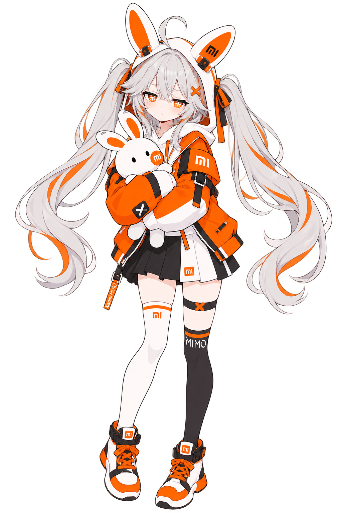

# MiMo / 小米

资料日期：2026-10-21。类型：`model-family`；状态：`local_assets`。

## 形象与版本

署名：甶丶（本轮已收立绘与三视图）；其他作者版本另列。

检索别称：MiMo娘、米莫、小米MiMo。

该页主要参考版本的识别点：

- 银白双马尾
- 橙黑服装、mi/MiMo标识
- 兔子与黑白不对称袜

甶丶的正常比例立绘与三视图来自同一作者原帖。此版本不是ZipZipPipe设计；许可CC BY-NC未写版本号。

## 本地文件

| 文件 | 类型/系列 | 使用说明 |
| --- | --- | --- |
| [初始设计正常比例立绘](../../assets/fuh-mimo/mimo/mimo-adult-01.png) | normal / fuh-mimo | CC-BY-NC |
| [作者三视图](../../assets/fuh-mimo/mimo/mimo-turnaround-02.png) | turnaround / fuh-mimo | CC-BY-NC |

文件保持原字节；完整作者、原帖、下载供应方和SHA-256见[assets.json](../../data/assets.json)。

## 本轮新增与扩写的作者版本

### 初始设计正常比例立绘 · fuh-mimo

橘白配色，抱着印有 mi 的兔子。作者动态标题为《娘化mimo》。

识别点：银白双马尾；橙黑服装与mi/MiMo标识；黑白不对称袜与兔子。

### 作者三视图 · fuh-mimo

同一作者、同一动态的正面 / 侧面 / 背面设定。

识别点：银白双马尾；橙黑服装与mi/MiMo标识；黑白不对称袜与兔子。

## 外部设定、三视图与作品

## 创作参考

以作者为分组，分别补全脸、配件和三视图；本次不从标题反推全部服装。

此段为本库编者建议。

## 来源

- [站点作品结构化数据](https://github.com/lmy414/bluedafeiyu/blob/main/data/works.json) · `pinned_repository_metadata`
- [shuaizenge/ai-girls更新后的目录说明](https://github.com/shuaizenge/ai-girls/blob/dcd69f5f4f2dff1a9c0031e82deb49e0fe949c76/README.md) · `pinned_repository_text`
- [shuaizenge/ai-girls更新后的作者与声音说明](https://github.com/shuaizenge/ai-girls/blob/dcd69f5f4f2dff1a9c0031e82deb49e0fe949c76/NOTICE.md) · `pinned_repository_text`
- [MiMo娘作者投稿与CC BY-NC声明](https://github.com/lmy414/ai-girl-stickers/issues/35) · `author_submission`

返回[角色总览](../../README.md) · [新增资料评述](../../docs/09-more-sources.md) · [版本比较](../../docs/10-variant-guide.md)。
