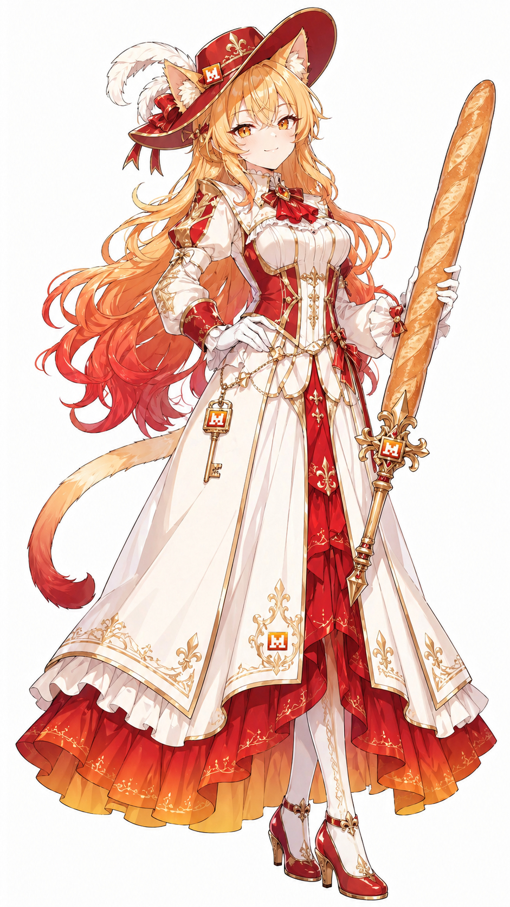

# Mistral

资料日期：2026-10-21。类型：`model-family`；状态：`local_assets`。

## 形象与版本

署名：ZipZipPipe。

检索别称：Mistral娘、米斯特拉尔娘。

该页主要参考版本的识别点：

- 金色长发
- 红色宽檐帽
- 红白法师裙

与Perplexity同属法师轮廓，但帽子形状和红白主色不同。小模型合照是作品主题，不是长期参数分类。

## 本地文件

| 文件 | 类型/系列 | 使用说明 |
| --- | --- | --- |
| [校园系列正面全身人设](../../assets/school-op/mistral/school-op-mistral.png) | school-portrait / school-op | CC-BY-NC-4.0 |
| [初始设计正常比例立绘](../../assets/zipzippipe/mistral/zipzippipe-pixiv-148186519-p09.jpg) | normal / zipzippipe | author_sharing_statement |

文件保持原字节；完整作者、原帖、下载供应方和SHA-256见[assets.json](../../data/assets.json)。

## 本轮新增与扩写的作者版本

### 校园系列 · school-op

本项目原创设计，区别红帽金发与法棍长剑版本。

识别点：橙色短发与红色挑染；像素M发夹；暖橙红领结。

[作者发布的提示词文件](https://github.com/lshhhhhhh/ai-school-op/blob/379e83eebe0f5c34eefa81ca4ef8203c1c54ae64/cast/designs/mistral.prompt.txt)。这是该派生系列的提示词，不冒充早期原角色提示词。

### 初始设计正常比例立绘 · zipzippipe

作者本人公开的立绘；成年仅作正常比例分类，不代表作者公布了角色年龄。礼帽、裙摆和钥匙上有 M 标识，手持法棍长剑。

识别点：金发红帽；红白裙装与M标识；法棍长剑。

## 外部设定、三视图与作品

- [Mistral 娘 · 角色立绘](https://www.bilibili.com/opus/1236803362705375305)；not_labeled。
- [Mistral、Perplexity、MiniMax、RWKV · 小模型合照](https://www.bilibili.com/opus/1237178790069665792)；not_labeled。

## 创作参考

可以围绕风、纸页、施法准备安排动作；额外加入的功能隐喻属于创作提案。

此段为本库编者建议。

## 来源

- [Mistral 娘：形象与角色档案 | Gender Swap AI](https://genderswapai.com/zh-CN/ai-gijinka/mistral) · `web_text`
- [ZipZipPipe的动态 - 哔哩哔哩](https://www.bilibili.com/opus/1236803362705375305) · `web_text`
- [ZipZipPipe的动态 - 哔哩哔哩](https://www.bilibili.com/opus/1237178790069665792) · `web_text`
- [ai-school-op：项目说明和图片许可](https://github.com/lshhhhhhh/ai-school-op/blob/379e83eebe0f5c34eefa81ca4ef8203c1c54ae64/README.md) · `pinned_repository_text`
- [18位校园AI娘演员表](https://github.com/lshhhhhhh/ai-school-op/blob/379e83eebe0f5c34eefa81ca4ef8203c1c54ae64/cast/README.md) · `pinned_repository_text`
- [校园mistral作者提示词](https://github.com/lshhhhhhh/ai-school-op/blob/379e83eebe0f5c34eefa81ca4ef8203c1c54ae64/cast/designs/mistral.prompt.txt) · `pinned_repository_text`
- [shuaizenge/ai-girls更新后的目录说明](https://github.com/shuaizenge/ai-girls/blob/dcd69f5f4f2dff1a9c0031e82deb49e0fe949c76/README.md) · `pinned_repository_text`
- [shuaizenge/ai-girls更新后的作者与声音说明](https://github.com/shuaizenge/ai-girls/blob/dcd69f5f4f2dff1a9c0031e82deb49e0fe949c76/NOTICE.md) · `pinned_repository_text`

返回[角色总览](../../README.md) · [新增资料评述](../../docs/09-more-sources.md) · [版本比较](../../docs/10-variant-guide.md)。
