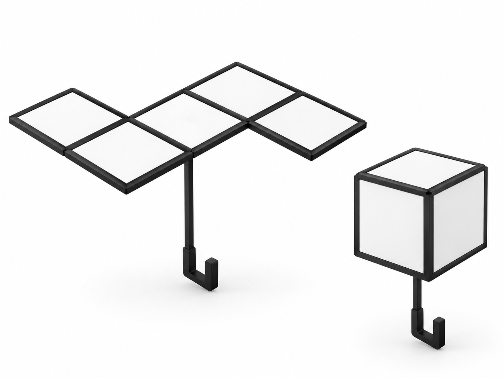

# StepFun / 阶跃星辰

资料日期：2026-10-21。状态：`local_assets`。

署名：甶丶，原作者投稿表明确使用AI辅助创作。

原作者投稿直接命名Stepfun娘与阶跃星辰。三张原PNG为两张持物立绘和一张专武图，不是三视图。

## 两张立绘与一张专武图

### StepFun持立方灯立绘

### StepFun持方格伞立绘

### StepFun专武：方灯与像素伞

## 来源与使用说明

[作者原动态](https://www.bilibili.com/opus/1250303372583501829) · [原作者投稿/许可](https://github.com/lmy414/ai-girl-stickers/issues/19)。原动态本轮返回页面壳，归属与许可依据实际读到的原作者投稿表；原PNG均已查看。

作者填写CC BY-NC，未写版本号。这里保留原字节和署名。方灯与伞是道具设计，不能当成侧面/背面角色图。

返回[角色总览](../../README.md) · [补缺专题](../../encyclopedia/gap-character-update.md)。
