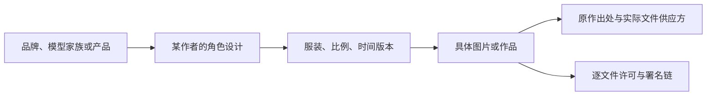

# 角色系统：把名字、设计和作品分开

## 为什么不能“一家AI一张图”

同一个产品可能同时有官方头像、成套社区立绘、另一位作者的Q版、桌宠皮肤和仅为一条短片设计的临时形象。它们可以都被叫作“某某娘”，但并不共享全部设定。反过来，同一画师的龙系设计也可能出现GPT、GPT Image / Image 2、Codex等独立分支。

本库使用四层概念：



作者、聚合站、投稿者、转载者、下载供应方是不同身份。某个GitHub仓库保存了图片，不能自动推断该仓库维护者画了这张图。

## 观察到的视觉语言

| 识别方式 | 本次例子 | 设计上有什么作用 | 记录时的问题 |
| --- | --- | --- | --- |
| 动物轮廓 | 鲸尾、猫耳、狐耳、龙翼、羽翼 | 缩小后仍容易认出 | 不能用动物名取代具体结构 |
| 颜色组合 | DeepSeek蓝白、Claude橙白、Gemini蓝紫 | 帮助群像区分 | 同色不代表同人；版本可能换色 |
| 职业与服装 | 女仆、法师、工程少女、中式长裙 | 将抽象服务转成可读角色 | 职业是作者设计，不是厂商事实 |
| 功能道具 | 书本、场记板、法杖、算盘 | 形成自然动作和场景 | 道具隐喻不能冒充技术说明 |
| 名称或品牌元素 | K、Z、星形、发饰 | 在近景里补足身份 | 标志与商标仍有独立权利 |
| 表情与反差 | 认真工作与休息、强大与吃饭 | 把使用体验变成小故事 | 角色笑话不能当作评测结论 |

“蓝色头发+女仆裙”仍然不够精确。真正能固定形象的是发型、脸、配件、尾巴结构和衣服分区共同出现。立绘适合记录这些稳定项，表情包适合记录它们在动作变化中怎样保留。

## 五组最容易混淆的关系

### 豆包官方头像 / Seed 娘 / 其他豆包同人

本次已从官网HTML直接取得并查看当前棕色短发头像，豆包页保留官方识别说明，当前以官网/CDN外链提供；未取得官方全身设定。原先唯一展示的校园同人图已明确作者，且演员槽位是教师、造型穿统一制服。ZipZipPipe的Seed版采用单马尾和豆包挂件；OpenPet还有另一种短发版本。仓库将Seed与豆包产品各列条目，并在描述里说明关系，避免把不同图当作同一作者的服装差分。

### GPT / GPT Image（Image 2）/ Codex

它们共享龙系视觉母题，但[GPT白龙娘](../characters/gpt/README.md)、[GPT Image / Image 2黑龙娘](../characters/image2/README.md)与[Codex龙娘](../characters/codex/README.md)分别建档。原帖名称Image 2与检索别名GPT Image同时保留；不把黑龙娘泛化为所有图像模型版本。三视图原帖尤其说明Codex设计来自群友。应把共享视觉母题和具体设计署名同时保存，不能只写一个“OpenAI娘”。

### GLM / Zcode

一个是模型家族条目，一个是编程工具条目。黑发狐娘和浅色蒙眼工程少女已经具备不同轮廓；即使技术生态有关，也不应共用同一张角色卡。

### Llama 的名称 / 本次猫耳造型

译名和角色物种不必一一对应。聚合档案描述猫耳，就先如实记录该版本。只有作者确认羊驼耳或后续重新设计时才添加新的版本，不强行纠正原画。

### 原比例立绘 / 作者“小AI”展示 / 后来的两头身Q版

三者都可用作参考，但文件性质不同。视频截帧含背景、过渡和展示画面，不是透明立绘。二次画师的两头身简化也不是原作者发布的原始小AI文件。

## 角色性格怎样从作品中提炼

先记录可观察行为：拿着饭碗、看手稿、等待结果、递道具、做检查。再记录该作品如何解释行为，例如“自信”“认真”“摸鱼”“腹黑”。最后才考虑是否值得归入某个作者系列的人设。

不要从单张图推出角色的全部人格，也不要从拟人角色推出模型真实情感。台词可以是截图改写、网络用语、作者编写或跨作品引用，应在作品层标明来源。CP、室友、姐妹、同事等关系也只在所收录系列内有效。

本库的`creative_options_original`是编者对未来创作的建议；`observed_traits`才是本次资料记录的外观线索。两者分开，让使用者知道哪部分可以直接当参考、哪部分需要自行决定。

## 版本字段建议

后续新增图时，建议使用稳定角色ID，再附作者系列、比例、服装和修订号。例如：

```text
deepseek / zipzippipe / normal / maid / early
deepseek / zipzippipe / normal / palace-maid / turnaround-post
deepseek / jadpp / normal / expression-angry / v1
gpt / zipzippipe / normal / early-portrait
gpt / jadpp / normal / recursive-weaver-v7
```

这些是本库的编目路径示例，不代表画师采用了相同官方版本号。原作者没有编号时保留原帖日期和文件标识即可，避免人为创造看似正式的设定。

## 怎样理解覆盖范围

主表混合模型家族、产品、编程工具、平台和历史产品，因为它们在同人创作中经常同时出现。每项用`entity_kind`标清类型，不拿它们做同一个模型能力排行榜。

“已有线索”表示找到作品或形象入口；“有角色档案”表示已提炼识别点；“有本地图片”表示有可核对来源的文件。三者不是同一个完成状态。待补产品不虚构视觉形象，也不计入已有形象数量。

## 人设、模型风格与视觉版本的对应

[新增人设栏目](../encyclopedia/personas/README.md)分别保存原创工作人设与作者资料摘要，示范对白单独标注原创。作者原设、作品观察、官方风格目标/功能语境分别列证据；真实模型对话采样仍记为0。人设新增不改变图像待补状态，也不将本库创作反向署给图像作者。

## 具体模型、版本与功能分支也收录

收录对象不限于厂商或聊天产品。具体图像/视频/语音模型、模型版本、编程助手及其他有明确社区拟人设计的功能分支，都可以进入图鉴。GPT Image / Image 2黑龙娘就是已有实例。

- 作者明确命名且形象身份独立时，可以单列角色，并关联同生态的其他角色。
- 同一作者的服装更新、常规/Q版或三视图，归入该角色的版本与文件，不按张数增造角色。
- 同一对象由不同作者重新设计，分别记录作者版本；同一素材的异名只补检索别名。
- 模型和产品的技术继承关系、作者虚构的家族关系、社区形成的人设梗分别写，不能互相代替。

本轮实例：[模型与工具分支专题](../encyclopedia/model-branches.md)。GPT-OSS、Gemma、Phi、Nemotron、MAI与Seedance已单列；同作者Opus/Sonnet与Claude Code文字方案作为具体分支关联。
