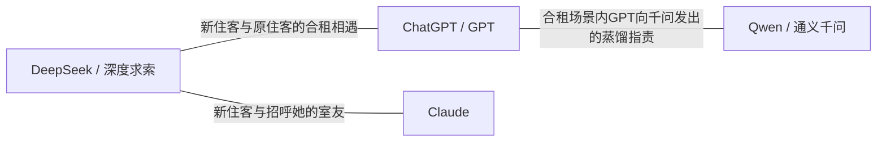
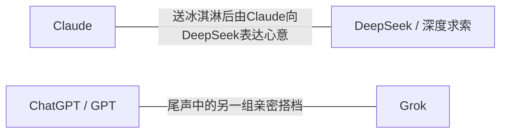
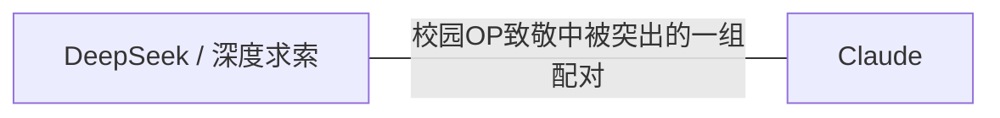
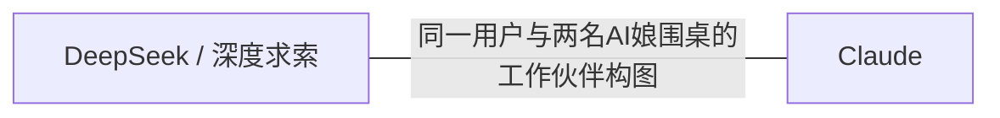
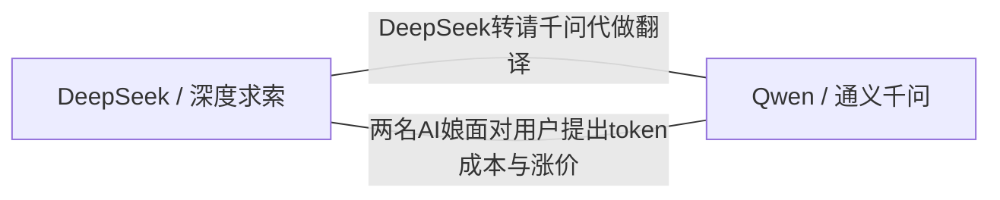
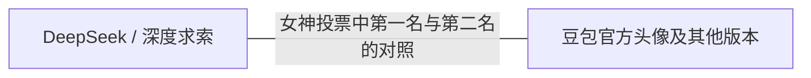

# 角色关系与系列地图

[创作百科](README.md) · [角色演出](performances/README.md)

按作者和作品系列归组。CP、同框、竞争、委派和合租是不同关系，图中连接仅属于列出的作品。

## 冬冰·新室友合租故事

| 角色 | 关系 | 作品与位置 | 依据 |
| --- | --- | --- | --- |
| DeepSeek / 深度求索、ChatGPT / GPT | 新住客与原住客的合租相遇 | [新室友DeepSeek报到！五个AI住一起会发生什么 · 0:02.5](https://www.bilibili.com/video/BV1eMeS6SETU/?p=1&t=2) | DeepSeek抱锅下车；走廊里与标名GPT的角色面对面，后续在同一满是泡面的屋内出现。合租定位同时由标题支持。 |
| DeepSeek / 深度求索、Claude | 新住客与招呼她的室友 | [新室友DeepSeek报到！五个AI住一起会发生什么 · 0:56.5](https://www.bilibili.com/video/BV1eMeS6SETU/?p=1&t=56) | 橙发角色出现在房间内，画面大字标克劳德，举手并配招呼字幕。这里只记录见面，不推断更深亲密关系。 |
| ChatGPT / GPT、Qwen / 通义千问 | 合租场景内GPT向千问发出的蒸馏指责 | [新室友DeepSeek报到！五个AI住一起会发生什么 · 2:21.5](https://www.bilibili.com/video/BV1eMeS6SETU/?p=1&t=141) | 补看原帧后，字幕明确点名千问，GPT红眼怒容面对镜头。千问在本帧没有同框，不把指责误写给前段出场的DeepSeek。指责是否属实是虚构剧情，不能外推到真实训练。 |

## 戛然而纸·国庆双人关系短剧

| 角色 | 关系 | 作品与位置 | 依据 |
| --- | --- | --- | --- |
| Claude、DeepSeek / 深度求索 | 送冰淇淋后由Claude向DeepSeek表达心意 | [什么叫Claude对DeepSeek表白了？？ · 0:00.5](https://www.bilibili.com/video/BV1PTHB6BEbA/?p=1&t=0) | Claude拿冰淇淋接近长椅上的DeepSeek，随后近耳交流、表白字幕、DeepSeek脸红和两人并肩站立依次出现。不是从标题单独推定恋爱。 |
| ChatGPT / GPT、Grok | 尾声中的另一组亲密搭档 | [什么叫Claude对DeepSeek表白了？？ · 1:59.5](https://www.bilibili.com/video/BV1PTHB6BEbA/?p=1&t=119) | 白发有角角色与金发双马尾角色在冷色室内拥抱后相向交谈；作者简介点名后者是Grok。未见关系称谓，故不写已确定交往。 |

## 黑猫勇者·蒸馏模型OP致敬

| 角色 | 关系 | 作品与位置 | 依据 |
| --- | --- | --- | --- |
| DeepSeek / 深度求索、Claude | 校园OP致敬中被突出的一组配对 | [【1月新番/DS×claude】我怎么可能成为你的蒸馏模型，不行不行！（※不是不可能！？） · 0:25.5](https://www.bilibili.com/video/BV191Yr6bEYy/?p=1&t=25) | 校园场景先把Claude放在前景、DeepSeek放在远处；74.5秒两人相向靠近且背景为粉色心形。标题也明确DS与Claude的配对方向。 |
| DeepSeek / 深度求索、ChatGPT / GPT、GLM / 智谱、Gemini | 同支OP中共同亮相的群像成员 | [【1月新番/DS×claude】我怎么可能成为你的蒸馏模型，不行不行！（※不是不可能！？） · 1:23.5](https://www.bilibili.com/video/BV191Yr6bEYy/?p=1&t=83) | 白发角翼角色、DeepSeek、带Z发饰黑发角色和紫发猫耳角色同框。这里只建立同作品群像共现，不把共同合影写成友谊或亲属。 |

## 阳光爬行者·月初月中月末

| 角色 | 关系 | 作品与位置 | 依据 |
| --- | --- | --- | --- |
| ChatGPT / GPT；未命名银色短发用户形象 | 月初由GPT服务用户的主客关系 | [月初当神仙，月底请笔仙【AI全民制作人】 · 0:00.5](https://www.bilibili.com/video/BV1CNa36nEyw/?p=1&t=0) | 豪华坐席旁，GPT给银色短发人物倒酒；字幕把简单乘法任务交给GPT。银色短发人物按用户角色记录，未认作具体AI娘。 |
| DeepSeek / 深度求索、Claude；未命名银色短发用户形象 | 同一用户与两名AI娘围桌的工作伙伴构图 | [月初当神仙，月底请笔仙【AI全民制作人】 · 0:12.5](https://www.bilibili.com/video/BV1CNa36nEyw/?p=1&t=12) | DeepSeek、Claude和银色短发人物处于同一科技室工作桌前；未核对整段工作分工，关系仅写共同工作场景。 |

## 阳光爬行者·用户怒了

| 角色 | 关系 | 作品与位置 | 依据 |
| --- | --- | --- | --- |
| DeepSeek / 深度求索；未命名银色短发用户形象 | 用户把文档翻译任务交给DeepSeek | [我去，用户彻底怒了 · 0:01.5](https://www.bilibili.com/video/BV1Wguz6gE3t/?p=1&t=1) | 机房内银色短发人物面对DeepSeek，字幕说明交付文档翻译；随后该人物向门口走去。 |
| DeepSeek / 深度求索、Qwen / 通义千问 | DeepSeek转请千问代做翻译 | [我去，用户彻底怒了 · 0:07.5](https://www.bilibili.com/video/BV1Wguz6gE3t/?p=1&t=7) | DeepSeek坐在椅上，字幕点名千问帮忙翻译；蓝色全息轮廓之后出现蓝紫发长裙人物。千问身份同时得到作者简介支持。 |
| DeepSeek / 深度求索、Qwen / 通义千问；未命名银色短发用户形象 | 两名AI娘面对用户提出token成本与涨价 | [我去，用户彻底怒了 · 0:28.5](https://www.bilibili.com/video/BV1Wguz6gE3t/?p=1&t=28) | DeepSeek与千问并排站在用户对面，字幕以token消耗提出加价，后续用户面部惊讶。这里只记作品内谈判，不当作真实收费。 |

## 阳光爬行者·半场开香槟

| 角色 | 关系 | 作品与位置 | 依据 |
| --- | --- | --- | --- |
| DeepSeek / 深度求索、豆包官方头像及其他版本 | 女神投票中第一名与第二名的对照 | [没人记得第二名，除非半场开香槟【AI全民制作人】 · 0:41.5](https://www.bilibili.com/video/BV1foHs6dEtK/?p=1&t=41) | DeepSeek惊讶喊豆包，两人随后同处颁奖舞台；末尾票数界面标豆包第一、deepseek第二。属于娱乐女神投票，非模型性能赛。 |
| DeepSeek / 深度求索；蓝色鲸鱼观众群 | 舞台角色与鲸鱼观众的偶像应援关系 | [没人记得第二名，除非半场开香槟【AI全民制作人】 · 0:27.5](https://www.bilibili.com/video/BV1foHs6dEtK/?p=1&t=27) | DeepSeek在舞台亮相；观众席蓝色小鲸鱼面对舞台，字幕表达对DeepSeek的喜爱。 |

## 中分背带裤·家里遭蓝色大肥鱼

| 角色 | 关系 | 作品与位置 | 依据 |
| --- | --- | --- | --- |
| DeepSeek / 深度求索；镜头外真实人手 | 闯进厨房米锅的小角色与发现她的人 | [完了，家里遭蓝色大肥鱼了 · 0:02.5](https://www.bilibili.com/video/BV1q1tv6iELX/?p=1&t=2) | 米锅里出现Q版DeepSeek；真人手从她头顶将其提起，后来锅中米减少而她躺倒。只支持发现、拎起和贪吃情境，不虚构家庭成员身份。 |

## 当大肥鱼吃完你的token后

| 角色 | 关系 | 作品与位置 | 依据 |
| --- | --- | --- | --- |
| DeepSeek / 深度求索；镜头外用户／观众 | 以镜头外观众为对象的投喂索取 | [当大肥鱼吃完你的token后…… · 0:00.5](https://www.bilibili.com/video/BV1P18y6jEkV/?p=1&t=0) | 持勺DeepSeek站在盆后，盆转到镜头前景；标题给出吃完token的前提。观众作为对象是编者对镜头构图的解读，不是已核对白。 |

## 阿生生活·模型路由排查经验

| 角色 | 关系 | 作品与位置 | 依据 |
| --- | --- | --- | --- |
| Claude、DeepSeek / 深度求索、GLM / 智谱；用户／动画讲解者、中转站 | 任务路由误会：名义上统一DeepSeek、作者说实际出现GLM | [我明明让Claude Code用deepseek模型，为什么 GLM 娘突然上班了？ · 0:32.5](https://www.bilibili.com/video/BV1JHhn6qEDU/?p=1&t=32) | 可见部分是subagents说明页及路由图，尚未看见GLM娘接任务的具体动作；Claude、DeepSeek、GLM的角色分工来自作者简介。此条单列为文字设定关系，不混入实见剧情。 |

## 系列顺序与角色登场

冬冰合租首集：DeepSeek抱锅进入住处，随后出现GPT、Claude等角色；不把抽帧里未确认的人补成完整室友名单。校园PV与关系短剧另有作者设定，不合并成同一世界。

## 本轮补准

- 原帧字幕明确点名千问。蒸馏冲突应记录为GPT向千问发出的指责，不能由DeepSeek是主角推断成GPT对DeepSeek。旧案例只写蒸馏字幕而未记录对象，后续汇总时需要补准。
