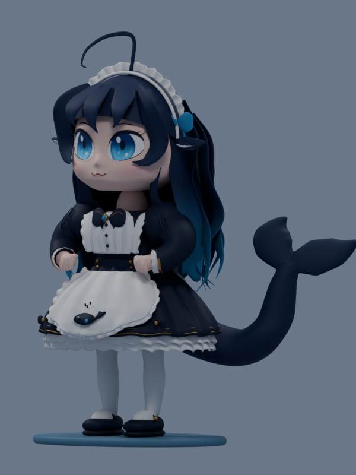
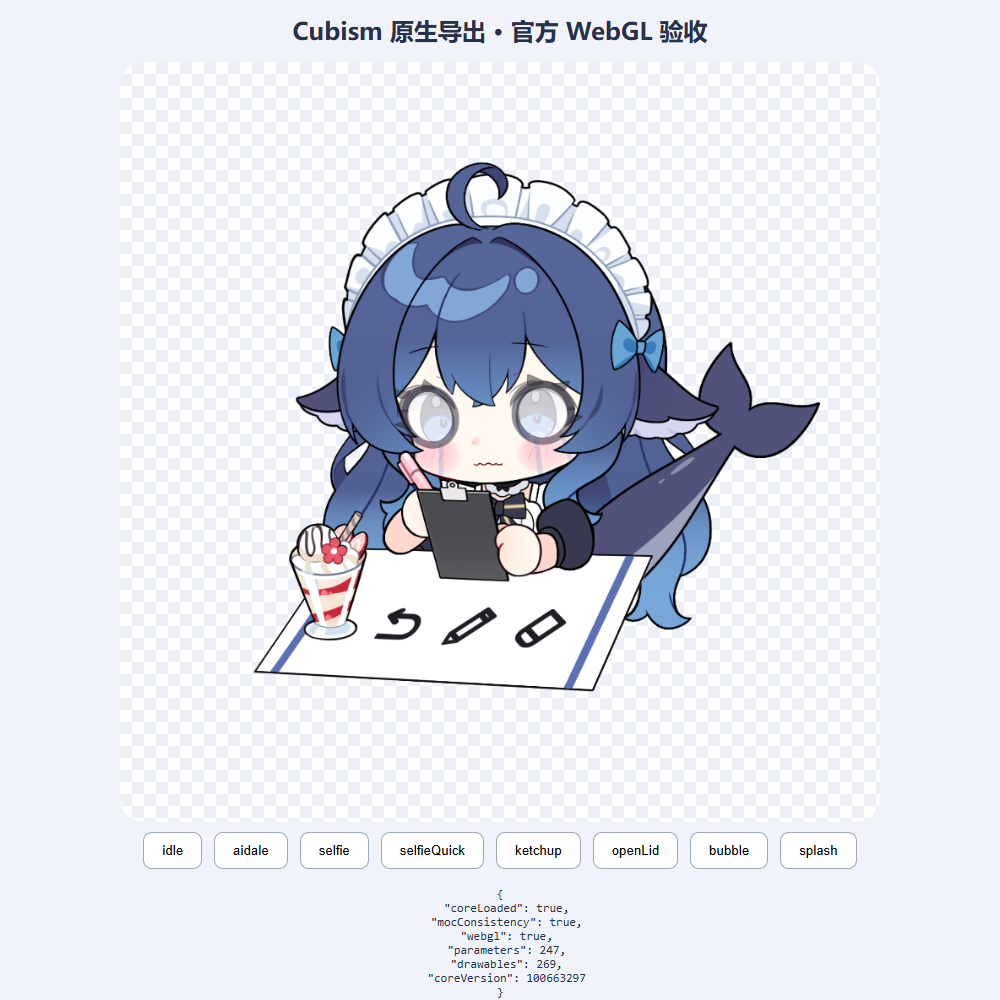
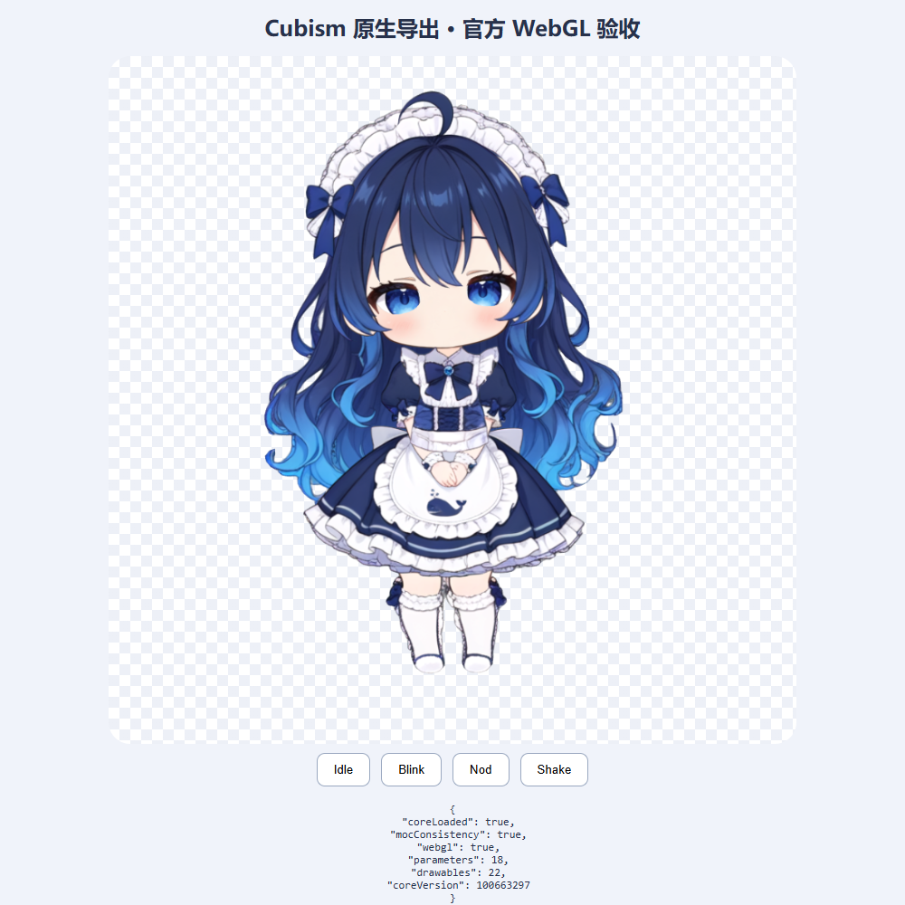

# 原文件取得与实际运行结果

[直接下载](ready-packages.md) · [素材关联包](production/README.md)

本轮实际取得原文件，按图片、精灵图、Blender与Cubism分别检查。执行的是素材格式与模型演出检查，未安装第三方聊天插件或接入个人账号。

| 材料 | 实际结果 |
| --- | --- |
| Blend与GLB | Blender 4.5.14 LTS打开/导入；各185个网格，实际渲染正面与斜侧面；均无骨骼或动作。 |
| 氵六青Live2D | 官方Core加载：247参数、269绘制对象。转头、闭眼、自拍、哭与星星眼通过采样；idle在1.2秒未产生可见变化，保留结果。 |
| 7l-ui Live2D | 官方Core加载：18参数、22绘制对象；转头、闭眼、Blink/Nod/Shake五项采样均有像素和顶点变化。 |
| 7l-ui源稿 | PSD为768×768、15层，图层PNG与CMO3实际取得；CMO3未Editor原生重开。 |
| 三张动画精灵图 | 实际解码：各1536×2288、9组变化帧、16个方向；在Edge播放待机并切换到打招呼。 |
| ComfyUI任务包 | ZIP实际取得，JSON与提交说明可读取；不把任务格式检查称作已完成GPU生图。 |

## 实际模型画面

三维模型来源：SelinLee / AI Moe Atlas，MaidAtelier派生线；CC BY-NC-SA 4.0。

氵六青模型；上善无形、ZipZipPipe、氵六青署名链，Andersen216整理。截图为本次SDK采样，未重新原生导出模型。

7l-ui独立分层/绑定分支。截图为本次SDK采样，原作者MIT说明随源文件保存。

## 使用时注意的具体区别

MOC3运行模型与PSD/CMO3源稿分别记录；静态三维与面捕模型分别记录；图集动画与Live2D分别记录。公开入口存在、实际取得、模型加载、采样可见变化有各自证据。详细数据见[material-checks.json](../data/material-checks.json)。
